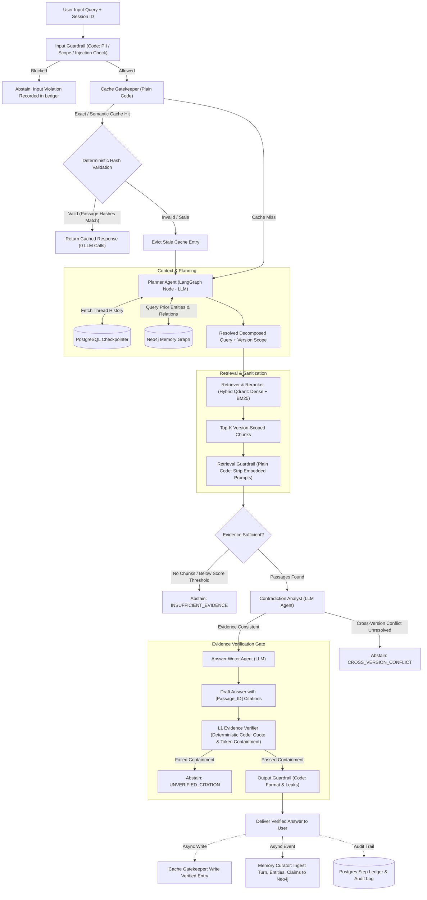
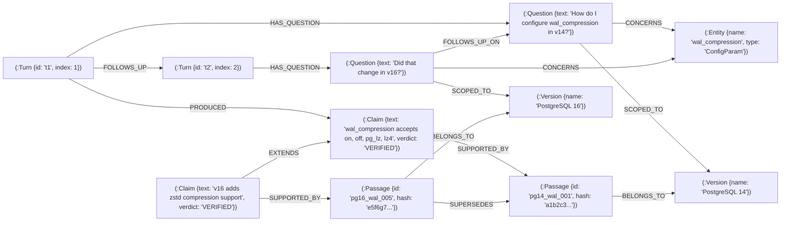

# Stage 2: System Architecture & Data Flow

This document details the multi-turn conversational flow, agent boundaries (code vs. LLM), the Neo4j memory schema, and the five-layer scoped cache design.

---

## 1. End-to-End Conversation Flow

The system processes queries through three explicit paths:
1. **Cache Hit Path** (Deterministic, 0 LLM calls, <15ms)
2. **Cache Miss & Retrieval Path** (Full agent pipeline with deterministic verification)
3. **Abstention Path** (Triggered when evidence is insufficient, contradictory, or unverifiable)



---

## 2. Honest Division: Agent vs. Plain Code

Not every step in an AI workflow should be an LLM agent. Using an agent where deterministic code suffices introduces latency, financial cost, and unpredictability.

| Component | Nature | Implementation | Justification |
| :--- | :--- | :--- | :--- |
| **Input Guardrails** | **Plain Code** | Regex, token length, injection patterns | Sub-millisecond latency. Deterministic filtering of PII and jailbreak patterns. |
| **Cache Gatekeeper** | **Plain Code** | Python HMAC hashing, Redis/Postgres | **Crucial:** Never ask an LLM if a cache hit occurred. Deterministic hash lookup only. |
| **Planner** | **LLM Agent** | LangGraph Node (Gemini) | Requires semantic reasoning to resolve follow-ups (e.g. *"Did that change in v16?"* $\rightarrow$ entity resolution). |
| **Retriever / Reranker**| **Code + Tool** | Qdrant Client + FastMCP | Deterministic vector + lexical search with hard metadata filters (`version == 16`). |
| **Retrieval Guardrail** | **Plain Code** | Text sanitization regex | Treats retrieved text as untrusted. Strips potential prompt injections before LLM sees them. |
| **Contradiction Analyst**| **LLM Agent** | LangGraph Node (Gemini) | Analyzes conflicting claims across version release notes and manuals. |
| **Answer Writer** | **LLM Agent** | LangGraph Node (Gemini) | Synthesizes answers strictly bound to cited passage IDs. |
| **L1 Evidence Verifier** | **Plain Code** | Deterministic String / Token Containment | Verifies every cited quote appears verbatim in the cited passage chunk. |
| **Memory Curator** | **Async Agent** | Background Worker (off user path) | Summarizes conversation entities, resolves graph relations, and updates Neo4j asynchronously. |
| **Judge (L2)** | **LLM Agent** | Independent Model (triggered only on low-confidence claims) | Provides second-opinion arbitration without penalizing standard path latency. |

---

## 3. Neo4j Conversational Memory Graph Schema

Instead of dumping conversation transcripts into the LLM prompt, EvidenceFlow AI structures multi-turn dialogue as a knowledge graph in Neo4j. This prevents context window bloat and allows precise entity-level lookups.



### Multi-Turn Resolution Example:
1. **Turn 1**: User asks: *"How do I configure `wal_compression` in PostgreSQL 14?"*
   - Planner creates `(:Turn {index: 1})`, `(:Question)`, links to `(:Entity {name: 'wal_compression'})` and `(:Version {name: '14'})`.
2. **Turn 2**: User asks: *"Did that change in 16?"*
   - The prompt contains ambiguous anaphora (*"that"*).
   - Planner inspects Neo4j: Finds the immediate prior `(:Turn)` focused on `wal_compression`.
   - Planner resolves the ambiguous query into: *"What changed with `wal_compression` in PostgreSQL 16 compared to PostgreSQL 14?"*
   - Qdrant query executes with filter: `version IN ['14', '16'] AND entity == 'wal_compression'`.

---

## 4. Five-Layer Scoped Cache Design

Caching in RAG is notoriously risky. Storing responses by raw query string guarantees stale answers when configurations, documentation versions, or guardrails change.

EvidenceFlow AI defines a **5-Layer Architecture**:

| Layer | Cache Store | Scope / Key Structure | Value Stored | Invalidation Trigger |
| :--- | :--- | :--- | :--- | :--- |
| **1. Exact Match** | Postgres / Redis | `HMAC(NormalizedQuery, VersionScope, ConfigHash)` | Full Verified Response + Citations | Corpus update, Config change |
| **2. Semantic Cache** | Qdrant Collection | Vector of Query + Payload Filter on `(VersionScope, Intent)` | Verified Answer (if cosine similarity $\ge 0.96$) | Corpus update, Guardrail change |
| **3. Retrieval Cache** | Postgres / Redis | `HMAC(QueryTerms, VersionFilter, TopK)` | List of `Passage_IDs` and scores | Corpus ingestion |
| **4. Embedding Cache** | Redis / Local LRU | `SHA256(TextChunk, ModelName)` | `list[float]` (Dense Embedding) | Model version bump |
| **5. Verified-Claim Cache**| Neo4j / Postgres | `(Entity, Attribute, VersionScope)` | Atomic Claim + Passage ID + Content Hash | Passage text change |

### The Composite Scope Key Formula:
$$\text{ScopeKey} = \text{SHA256}\Big(\text{Intent} \;\parallel\; \text{CorpusVersion} \;\parallel\; \text{GuardrailVersion} \;\parallel\; \text{ConfigVersion} \;\parallel\; \text{Normalize}(\text{Query})\Big)$$

### Zero-LLM Deterministic Hit Validation:
When Layer 1 or Layer 2 signals a match, it is **not** immediately returned. The Gatekeeper executes this deterministic verification:
```python
def validate_cache_hit(entry: CacheEntry, db_session) -> bool:
    # 1. Verify guardrail and config versions match current runtime
    if entry.guardrail_version != CURRENT_GUARDRAIL_VERSION:
        return False
    if entry.config_version != CURRENT_CONFIG_VERSION:
        return False

    # 2. Check each cited passage hash against live corpus state in Postgres
    for citation in entry.citations:
        current_hash = db_session.get_passage_hash(citation.passage_id)
        if current_hash is None or current_hash != citation.chunk_hash:
            # Document chunk has been modified or deleted! Evict cache.
            return False
            
    return True
```

---

## 5. Standardized Abstention Protocol

When the system cannot prove a claim from verified evidence, it must **never** hallucinate or provide unverified advice.

Standard Abstention Response Structure:
```json
{
  "status": "ABSTAIN",
  "reason_code": "INSUFFICIENT_EVIDENCE | CROSS_VERSION_CONFLICT | UNVERIFIED_CITATION | SCOPE_VIOLATION",
  "message": "The documentation for PostgreSQL 16 does not contain verified evidence regarding the requested parameter.",
  "attempted_scope": {
    "version": "16",
    "entities_detected": ["unknown_param"]
  },
  "retrieved_candidates": [
    {"passage_id": "pg16_misc_12", "relevance_score": 0.42}
  ],
  "audit_trail_step_id": "step_894f2a"
}
```
